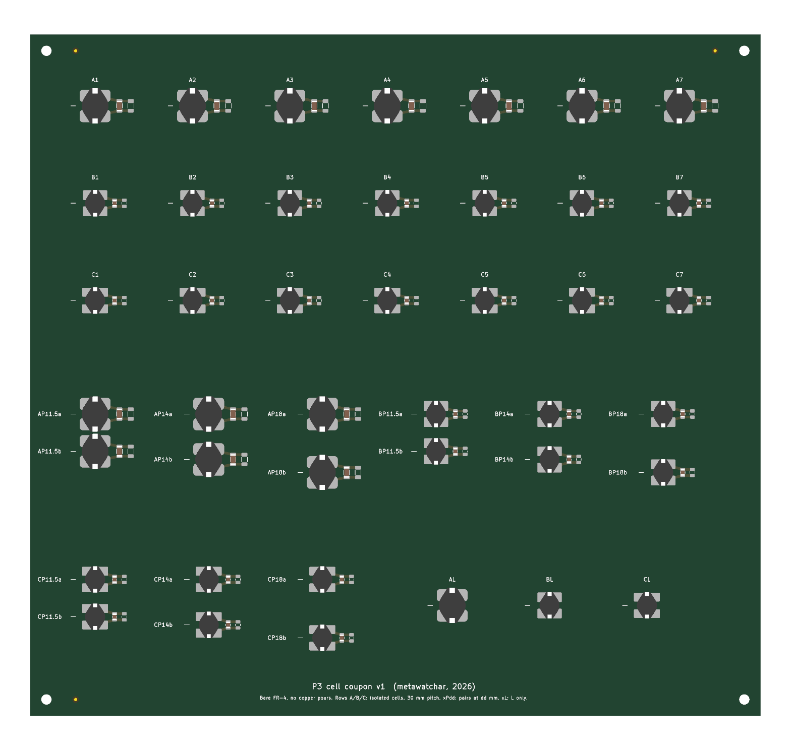

# P3 cell coupon v1

Test board for the lumped LC cells of the 85 kHz magnetic metamaterial slab (study P3). It measures, before any slab is designed:

- single-cell resonance f0 and quality factor Q, and their spread across nominally identical cells;
- the coupling between two coplanar cells at three spacings (in-situ check of the mutual-inductance model);
- the effect of an inductor alone (no capacitor) as a non-resonant control.



## Cells

Every cell is a closed loop: one unshielded ferrite drum inductor (axis normal to the board) and one C0G capacitor, plus an unpopulated pad for a parallel trim capacitor (C2, DNP).

| Type | Inductor (LCSC) | Capacitor (LCSC) | Nominal f0 |
|---|---|---|---|
| A | Sumida CD105T125NP-470KC, 47 µH ±10 %, Ø10.4 mm (C171573) | Murata GRM3195C1H683JA05D, 68 nF C0G 1206 (C3847777) | 89.1 kHz |
| B | SXN SM7850-101MT, 100 µH ±20 %, Ø7.8 mm (C10155) | TDK C2012C0G1H333JT000N, 33 nF C0G 0805 (C76628) | 87.6 kHz |
| C | Bourns SDR0805-101KL, 100 µH ±10 %, Ø7.8 mm (C139487) | TDK C2012C0G1H333JT000N, 33 nF C0G 0805 (C76628) | 87.6 kHz |

Inductor footprints are in `footprints.pretty/`, drawn from the manufacturers' recommended land patterns (Sumida CD105/T125 Ver. 2021-03-05; SXN SM series p. 2; Bourns SDR0805). The 3D bodies reuse KiCad's SDR1806 model scaled to size, for visualisation only.

## Layout (225 × 210 mm, 2-layer FR-4, no copper pours)

| Group | IDs | Purpose |
|---|---|---|
| Isolated cells | A1–A7, B1–B7, C1–C7 | f0, Q and spread. 30 mm pitch keeps neighbour coupling k ≲ 10⁻³, well below 1/Q. |
| Pairs | xP11.5a/b, xP14a/b, xP18a/b (x = A, B, C) | Coplanar pairs at 11.5, 14 and 18 mm centre spacing. The pair splits into two modes; the splitting gives the coupling k(d) where it exceeds the linewidth. |
| L only | AL, BL, CL | Inductor without capacitor: the non-resonant control. |

There are no copper planes anywhere, so no eddy-current loading. The four M3 holes at the corners locate a 3D-printed probe jig. Cell positions are listed in `out/cell_map.json`.

## Measurement plan

1. **Isolated cells.** Two small loop probes, weakly coupled, are placed over the inductor and read as S21 on the VNA. Fit f0 and the loaded Q, and check that the coupling is weak (|S21| below about −30 dB at resonance).
2. **Pairs.** Measure both mode frequencies f± and use k = (f+² − f−²)/(f+² + f−²). For coplanar cells k < 0, so the symmetric mode lies higher. Weak pairs (18 mm) may not split beyond the linewidth. The inductor's dipole moment m_eff is measured directly from Z21 between two inductors on SMA tabs (next board), and these pairs check that value in situ.
3. **L only.** The same probe measurement with no resonance. It shows the probe loading caused by the ferrite alone.
4. **Trim.** C2 lets a cell be pulled down to exactly 85 kHz if needed.

## Fabrication files (`out/jlc/`)

- `gerbers_p3_cell_coupon.zip`: Gerber and drill files.
- `BOM_p3_cell_coupon.csv` and `CPL_p3_cell_coupon.csv`: JLCPCB PCBA files, top side only, 81 placements, 5 line items, all Extended parts.
- Suggested order: 1.6 mm FR-4, 1 oz copper, ENIG (flat pads for the large inductor lands), 5 boards, 2 assembled.

**Check in the JLCPCB DFM preview before paying:**
- Inductor rotation: both pads must lie along the board's y axis.
- The SDR0805 pad gap is read from the datasheet figure as 2.4 mm. Compare it with the library footprint of C139487.

## Regenerate

```bash
"C:/Program Files/KiCad/10.0/bin/python.exe" coupon_cells.py
```

Then run DRC and the exports with `kicad-cli` and `python make_jlc.py` in `out/`. The commands are listed in the script header.

## Still to design

- Probe board: shielded loop probes and a Helmholtz pair.
- Board 2: SMA tabs (inductor alone for Z21 vs distance, capacitor alone), 4 × 4 mini-arrays, and printed-spiral reference cells.
- The 3D-printed jig.
