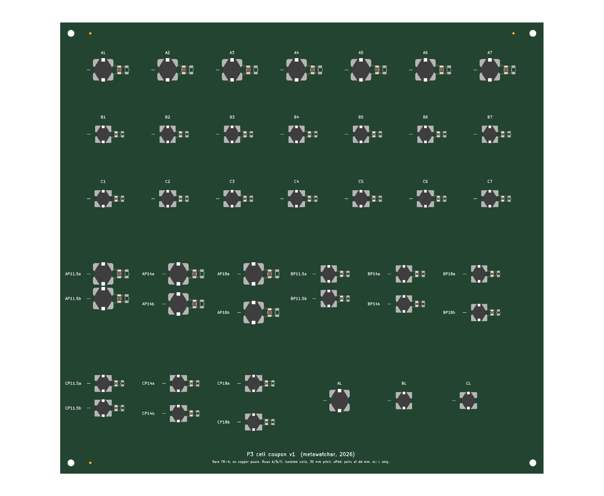

# P3 coupons and test fixtures (v1)

Boards for characterising the lumped LC cells of the 85 kHz magnetic metamaterial slab (study P3) before the slab itself is designed. All boards are generated by scripts (KiCad 10 Python) and checked by DRC: 0 errors, 0 warnings, no unconnected items.

| Board | Script | Size | Stack | Assembly | Purpose |
|---|---|---|---|---|---|
| `p3_cell_coupon` | `coupon_cells.py` | 225 × 210 mm | 2-layer, 1 oz | JLCPCB PCBA (81 parts) | Isolated cells (f0, Q, spread), coplanar pairs, L-only controls |
| `p3_array_coupon` | `coupon_arrays.py` | 270 × 185 mm | 2-layer, **2 oz** | JLCPCB PCBA (100 parts) + 1 hand-soldered SMA | 4 × 4 mini-arrays per cell type; printed-spiral reference cells |
| `p3_ztab` | `small_boards.py` | 11 × 52 mm | 2-layer, 1 oz | hand | One drum inductor + edge SMA: L, ESR, Q and Z21 vs distance (m_eff) |
| `p3_probe10`, `p3_probe20` | `small_boards.py` | 12 / 22 × 85 mm | **4-layer** | hand (SMA) | Shielded H-field loop probes, loop OD 10 / 20 mm |
| `p3_helmholtz` | `small_boards.py` | 110 × 110 mm | 2-layer, **2 oz** | hand (2 wires) | One coil of a Helmholtz pair for probe calibration |

Shared code: `p3pcb.py` (builder, cell types, spiral, export chain). Custom footprints: `footprints.pretty/`. Outputs: `out/` (boards, renders, DRC reports, cell maps) and `out/jlc_<board>/` (Gerber zip, BOM and CPL for JLCPCB).



## Cell types

Each cell is a closed loop: one unshielded ferrite drum inductor (axis normal to the board) and a C0G capacitor.

| Type | Inductor (LCSC) | Capacitor (LCSC) | Nominal f0 |
|---|---|---|---|
| A | Sumida CD105T125NP-470KC, 47 µH ±10 %, Ø10.4 mm (C171573) | Murata GRM3195C1H683JA05D, 68 nF C0G 1206 (C3847777) | 89.1 kHz |
| B | SXN SM7850-101MT, 100 µH ±20 %, Ø7.8 mm (C10155) | TDK C2012C0G1H333JT000N, 33 nF C0G 0805 (C76628) | 87.6 kHz |
| C | Bourns SDR0805-101KL, 100 µH ±10 %, Ø7.8 mm (C139487) | TDK C2012C0G1H333JT000N, 33 nF C0G 0805 (C76628) | 87.6 kHz |

Inductor footprints follow the manufacturers' recommended land patterns (Sumida CD105/T125 Ver. 2021-03-05; SXN SM series p. 2; Bourns SDR0805). The Z-tab uses one universal land that covers all three. The 3D bodies reuse KiCad's SDR1806 model scaled to size, for visualisation only.

## Board 1: cell coupon

- **Isolated cells A1–A7, B1–B7, C1–C7** at 30 mm pitch (neighbour coupling k ≲ 10⁻³, below 1/Q). Each has a DNP pad for a parallel trim capacitor.
- **Pairs xP11.5, xP14, xP18** (x = A, B, C): coplanar cells at 11.5, 14 and 18 mm centre spacing. The pair splits into two modes, and k = (f+² − f−²)/(f+² + f−²) where the splitting exceeds the linewidth. For coplanar cells k < 0.
- **AL, BL, CL**: inductor without a capacitor (the non-resonant control).
- Four M3 holes locate the 3D-printed probe jig. Cell coordinates are in `out/p3_cell_coupon_map.json`.

## Board 2: mini-arrays and printed reference cells

- **4 × 4 arrays**: type A at 15 mm pitch, B and C at 12.5 mm. The capacitor sits in the gap beside each inductor; there are no trim pads. These show the collective (uniform) mode of a small lattice, which is checked against the full mutual-inductance model.
- **S1, S2**: printed square spiral, 38 mm, 17 turns, 0.6 mm trace with 0.25 mm gap, top layer, bottom-layer crossover. L ≈ 7.7 µH (modified Wheeler), with 2 × 220 nF C0G (Murata GRM31C5C1H224JE02L, C464977) giving 86.7 kHz nominal, plus a DNP trim pad. Q is only about 6 at most, even with 2 oz copper. This is the exactly modelled reference cell, not a performance cell.
- **SZ**: the same spiral with no capacitor, wired to an edge SMA (J1, hand-soldered) for a direct measurement of L and R.

## Small boards

- **Z-tab**: the inductor sits at the tip (11 mm wide, so two tabs side by side reach 11.5 mm centre spacing) and the edge SMA at the far end. The feed is a top/bottom broadside pair, which keeps the lead loop small.
  - One tab gives L, ESR and Q.
  - Two tabs on the jig give Z21 = jωM against distance, which is fitted to M = μ0 m_eff² / (4π d³) for the coplanar case (and the coaxial case if stacked).
  - Order 10.
- **Loop probes**: two turns on each inner layer (four in series, OD 10 or 20 mm). Both outer layers are a ground shield, slit from the loop centre to the tip, so H passes, E is blocked, and the shield forms no shorted turn. Stitching vias run along the stem. The loop meets ground only at the connector, through a net tie.
  - The pair is used weakly coupled for cell f0/Q, and singly for field maps.
- **Helmholtz coil**: a 10-turn circular spiral, r = 46 → 34 mm (mean 40 mm). Two boards go on 40 mm spacers with the coils in series. The calibration field is computed from the actual track geometry (Biot–Savart), not from the ideal-loop formula.

## Ordering (one batch)

| Board | Qty | Options |
|---|---|---|
| Cell coupon | 5 PCB, 2 assembled | FR-4 1.6 mm, 1 oz, ENIG (flat lands for the large inductors), PCBA top side |
| Array coupon | 5 PCB, 2 assembled | FR-4 1.6 mm, **2 oz**, ENIG, PCBA top side |
| Z-tab | 10 | FR-4 1.6 mm, 1 oz |
| Probe 10, Probe 20 | 5 each | **4-layer**, 1.6 mm, standard stack-up |
| Helmholtz | 5 (2 needed) | FR-4 1.6 mm, **2 oz** |

**Loose parts for hand assembly:**
- Drum inductors of each type for the Z-tabs (about 4 of each).
- Edge-mount SMA jacks for 1.6 mm boards: 4 for the probes, 1 for SZ, and up to 10 for Z-tabs. The footprint is Samtec SMA-J-P-H-ST-EM1. Check that any generic edge SMA you buy matches its pads (centre 1.27 × 3.2 mm; grounds at ±2.825 mm, top and bottom).
- M3 nylon spacers, 40 mm, for the Helmholtz pair.

**Check in the JLCPCB DFM preview before paying:**
- Inductor rotation: both pads must lie along the board's y axis.
- The SDR0805 pad gap is read from the datasheet figure as 2.4 mm. Compare it with the library footprint of C139487.
- On the array coupon, the capacitor positions between the inductors.

## Regenerate

```bash
"C:/Program Files/KiCad/10.0/bin/python.exe" coupon_cells.py
```

Run `coupon_arrays.py` and `small_boards.py` the same way. Each script saves the board and then runs DRC, the Gerber/drill/position exports, the JLCPCB BOM/CPL and the renders.

## Not included yet

- The 3D-printed probe jig.
- TX/RX WPT coils and the slab itself. These are designed after the coupon data (cell Q, m_eff and spread) are measured.
