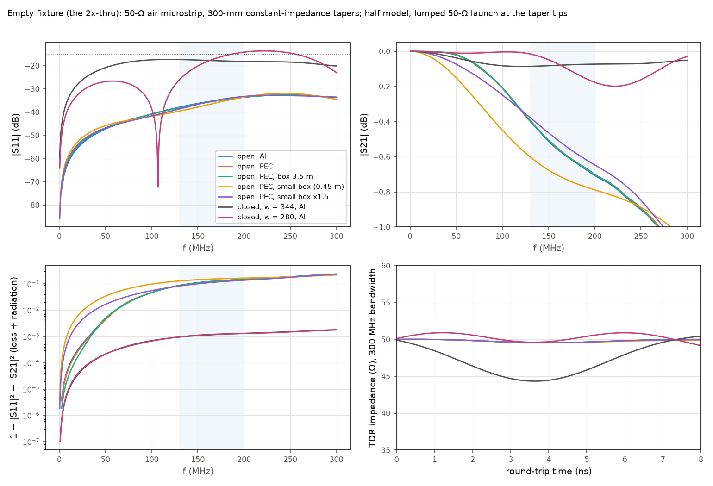
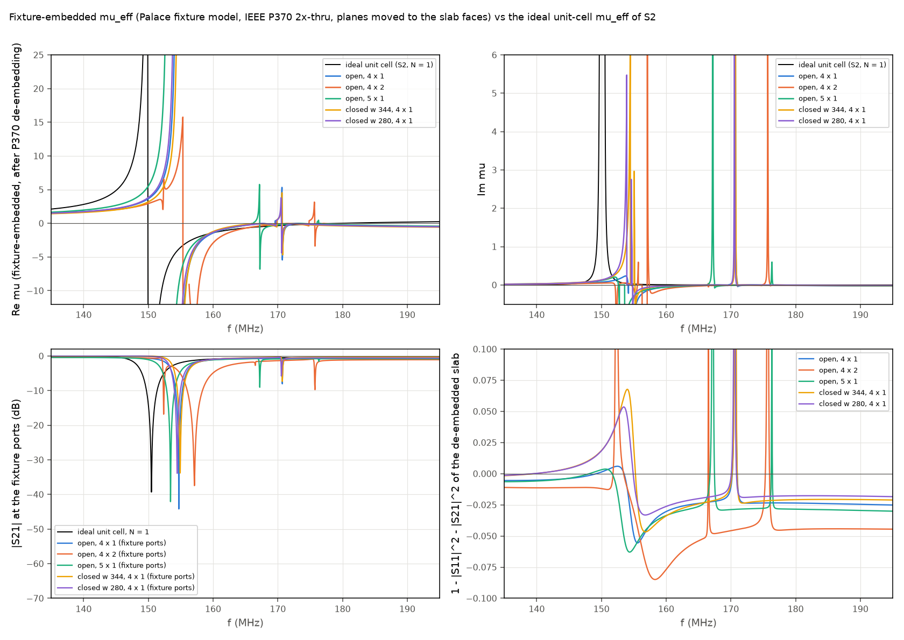
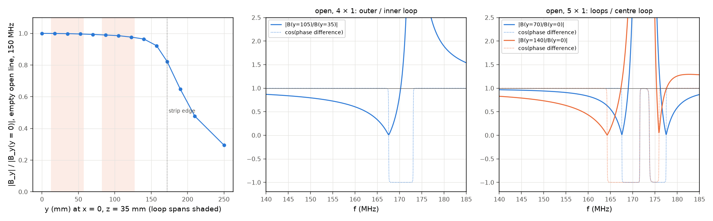

# S2 fixture: results

Full-wave Palace model of the TEM-line fixture for measuring μ_eff of the LGR meta-atom slab, with and without the slab, followed by the same IEEE P370 2x-thru de-embedding and retrieval that will be applied to VNA data. Model and method: [`README.md`](README.md). The reference is the ideal unit-cell μ_eff of [`../s2_mng_slab`](../s2_mng_slab) (corrected copper input, `S_N1_cu2`, `S_N2_cu2`).

## Answer in brief

1. **The empty fixture is well matched.** The open 50-Ω air microstrip has Z0 = 49.55 Ω (cross-section statics; band-limited TDR of the 2x-thru 49.56 Ω) and worst |S11| = −33.5 dB over 130–200 MHz, far inside the −15 dB goal. The first transverse resonance is not reached: the closed variant's first higher-order mode cuts off at 297 MHz, and the open line's odd mode lies higher still (≈ 370 MHz estimate; it is not excited in a symmetric fixture).
2. **But the open fixture radiates:** 8.7–15 % of the incident power over 130–200 MHz (11.0 % at 150 MHz), converged with the air-box size. The radiation comes from the tapers. Aluminium loss is only 0.09 %.
3. **The fixture does not return the ideal μ_eff.** With 4 cells across, the retrieved, fixture-embedded μ_eff has its resonance (pole) at 154.7 MHz instead of 149.9 MHz (+4.8 MHz, +3.2 %). Re μ below the resonance is only 41–70 % of the ideal value at 140–145 MHz (2.19 against 4.86 at 145 MHz). Transverse "edge" resonances of the 4-cell row appear at 167–176 MHz inside the MNG band, and the ideal upper band edge (μ′ = 0 at 179.6 MHz) is not recovered. The raw |S21| dip at the fixture ports, which involves no de-embedding at all, moves the same way: 150.5 → 154.7 MHz.
4. **The cause is the finite row width (a demagnetization effect), not field non-uniformity.** The empty line's field is uniform to 1.4 % over the inner loop and 2.4 % over the outer loop. But a 4-wide row has no neighbours beyond its edges, so the outer loops carry only 0.80 of the inner loops' field at 150 MHz (0.73 for the outer loops of a 5-wide row). The row's collective resonance therefore moves up towards the μ = 0 frequency. Five cells across shrink the shift only to +3.5 MHz (pole 153.4 MHz).
5. **De-embedding residual.** The P370 chain itself is accurate on synthetic data (median |Δμ| 0.0035 for a 49.5-Ω line). On the full-wave data, however, the de-embedded slab is up to 3–8 % non-passive in the stop band (≤ 0.6 % below 150 MHz). The causes are the open fixture's radiation, which couples the two tapers through free space and is not a cascade of two error boxes, and, in the closed variants, the taper mismatch (−14 to −17 dB), which 300 MHz of bandwidth cannot time-gate cleanly.
6. **Recommendation: build it closed, with the strip narrowed to 280 mm and the tapers re-profiled inside the box.** Use it for a model-based comparison (raw S-parameters against this fixture model), not for a direct "ideal μ_eff" measurement. Order **10 meta-atoms**: the 4 × 2 slab plus 2 spares, which also allows a 5 × 1 check.

## 1. Empty fixture (2x-thru)

| Run | Variant | worst \|S11\| 130–200 MHz | \|S21\| 130–200 MHz | 1 − \|S11\|² − \|S21\|² at 150 / 200 MHz | Z0 (statics) | TDR Z at centre |
|---|---|---|---|---|---|---|
| `openfar_nx0_al_o2b` | open, Al, air box 2.5 m | **−33.5 dB** | −0.40 to −0.71 dB | 0.111 / 0.150 | 49.55 Ω | 49.56 Ω |
| `openfar_nx0_pec_o2b` | open, PEC | −33.6 dB | −0.39 to −0.70 dB | 0.110 / 0.149 | | 49.56 Ω |
| `openfar35_nx0_pec_o2b` | open, PEC, air box 3.5 m | −33.6 dB | −0.39 to −0.70 dB | 0.110 / 0.149 | | 49.55 Ω |
| `closed_nx0_al_o2` | closed, w = 344 mm | −17.3 dB | −0.07 to −0.09 dB | 0.0011 / 0.0013 | 42.53 Ω | 44.4 Ω (band-limited) |
| `closedw280_nx0_al_o2` | closed, w = 280 mm | −14.2 dB (taper not re-profiled) | −0.02 to −0.18 dB | 0.0011 / 0.0013 | 50.68 Ω | 49.6 Ω (band-limited) |

- **Characteristic impedance.** The 2 mm strip thickness lowers the Hammerstad zero-thickness value (50.0 Ω) to 49.55 Ω. That is a 0.45 % mismatch, which the renormalized de-embedding removes.
- **Radiation (open).** The power through the absorbing boundary (`surface-F`) equals 1 − |S11|² − |S21|² of the PEC fixture to within 2 %, so the loss is radiation. Growing the box from 2.5 m to 3.5 m changes it by 0.3 % (0.1100 → 0.1097 at 150 MHz). It grows about as f³ at low frequency (0.44 % at 50 MHz, 4.6 % at 100 MHz). A vertical-current estimate for the two sloping tapers, each rising 67 mm (two short monopoles over ground, 2 R_rad/Z0 ≈ 7 % at 150 MHz), gives the right order. The ground plane is modelled as infinite; the real 504-mm plate will change the number, but not its order.
- **Air box too small: a documented failure.** With the first box (0.45 m from the strip, `open_nx0_*`), the first-order absorbing boundary absorbed the line's near field: 0.16 % "loss" at 10 MHz against 0.01 % in the 2.5 m box, and 14.4 % against 11.0 % at 150 MHz. The open-variant results below all use the 2.5 m box.
- **Higher-order modes.** For the closed cross-section (504 × 300 mm, strip 344 mm), FD statics give cut-offs of 297 MHz (TE, even family, the TE10-like mode), 305 MHz (TE, odd) and ≥ 720 MHz (TM). The 130–200 MHz band is clear, but the 2x-thru sweep cannot usefully go above about 290 MHz. For the open line, the odd mode, E_z ∝ sin(πy/w_eff), is estimated at c/(2 w_eff) ≈ 370 MHz. This needs verification: the half model with a magnetic symmetry wall cannot excite it, and Palace's 2D boundary-mode solver stalled on this cross-section (open issues).
- **Conductor loss.** Al 6061 (σ = 2.5e7 S/m) costs 0.09 % at 150 MHz (open: Al − PEC), i.e. 0.004 dB. Copper would make no difference.

## 2. Slab in the fixture: fixture-embedded μ_eff against the ideal

μ_eff in the physics convention (μ″ > 0 = loss). "Pole" = frequency of maximum μ″. The ideal values are the S2 unit cell (N = 1, order 3, corrected copper).

| Case | Raw \|S21\| dip (fixture ports) | Pole | Re μ / Im μ at 140 MHz | at 145 MHz | at 160 MHz | at 185 MHz | Min. 1 − \|S11\|² − \|S21\|² after de-embedding (all / < 150 MHz) |
|---|---|---|---|---|---|---|---|
| **ideal unit cell** (S2) | −39.3 dB at 150.48 MHz | **149.9 MHz** | 2.81 / 0.005 | 4.86 / 0.021 | −1.40 / 0.006 | 0.110 / 0.0006 | — |
| open, 4 × 1 | −44.2 dB at 154.72 MHz | 154.7 MHz | 1.73 / 0.023 | 2.19 / 0.036 | −1.44 / (−0.054) | −0.40 | −0.056 / −0.006 |
| open, 4 × 2 | −37.5 dB at 157.12 MHz | 157.1 MHz | 1.67 / 0.022 | 2.03 / 0.031 | −2.92 | −0.33 | −0.085 / −0.012 |
| open, 5 × 1 | −42.1 dB at 153.43 MHz | 153.4 MHz | 1.96 / 0.031 | 2.66 / 0.050 | −1.33 | −0.31 | −0.063 / −0.006 |
| closed w 344, 4 × 1 | −33.8 dB at 154.92 MHz | 154.7 MHz | 1.62 / 0.032 | 2.00 / 0.054 | −1.22 | −0.47 | −0.047 / −0.003 |
| closed w 280, 4 × 1 | −33.9 dB at 154.46 MHz | 154.2 MHz | 1.74 / 0.028 | 2.22 / 0.049 | −1.35 | −0.40 | −0.033 / −0.002 |

What agrees and what does not:

- **Below the resonance (130–148 MHz)**, the de-embedded data are passive to within 0.6 % and the retrieval is clean (ε_eff ≈ 1.6–1.9). But Re μ_fix is only 0.21–0.78 of the ideal value, and the ratio falls towards the resonance, because the fixture's resonance sits higher. **Im μ** is 4–6× the ideal value at 140 MHz in every case. In the open fixture this partly reflects the radiation, which de-embeds imperfectly (see below).
- **Resonance (pole):** +4.8 MHz for 4 × 1 in both the open and the closed fixture, +3.5 MHz for 5 × 1, and +7.2 MHz for 4 × 2. **The MNG band** starts at 154.3 MHz (4 × 1) instead of 149.9 MHz.
- **Homogenization (N_x = 1 against 2) fails in the fixture.** The 4 × 2 pole is 2.4 MHz above the 4 × 1 pole, whereas the ideal slab shows ≤ 0.05 MHz between N = 1, 2 and 4. The 4 × 2 slab also shows extra resonances at 152.3 and 175.7 MHz: modes that are antisymmetric along x and across the row.
- **Upper MNG edge:** the ideal μ′ = 0 crossing at 179.6 MHz is not recovered. Above 172 MHz, μ_fix stays at −0.1 to −0.6 with a small negative μ″, in the region where the de-embedded data are 2–3 % active. The value there is a de-embedding artifact, not a measurement of μ.
- **Series-reluctance (demagnetization) model.** A fit of 1/μ_fix = p/μ + 1 − p below 146 MHz gives p = 0.66 (open 4 × 1), 0.62 (4 × 2), 0.76 (5 × 1), 0.60 / 0.66 (closed w 344 / 280). The homogenized cross-section statics give p = 0.53 (open 4-wide), 0.66 (5-wide) and 0.45 (closed w 344). So the statics show the right trend but overestimate the demagnetization: they predict the pole at 162 MHz against 154.7 MHz. With p fitted below the resonance, the one-parameter model still puts the pole at 155–160 MHz, 1–5 MHz off. **A one-parameter analytic correction of measured μ_fix back to the ideal μ_eff is therefore not accurate enough** near the resonance. The full-wave fixture model is needed.

## 3. Edge effect: outer against central cells

- **Empty line field** (|B_y| at mid-height, 150 MHz, relative to y = 0): 0.998 at y = 35 mm (inner-loop centre), 0.986 at 105 mm (outer-loop centre), 0.976 at 122.5 mm, 0.964 at 140 mm, 0.82 at the strip edge (172 mm). The illumination of the 4 loops is uniform to ≤ 2.4 %, matching the statics (which give ≤ 0.5 % for the TEM E_z).
- **With the cells** (B_y at the loop-bore centres, open 4 × 1): outer/inner = 0.87 at 140 MHz, **0.80 at 150 MHz**, 0.74 at 154 MHz, 0.61 at 160 MHz, in phase. The collective mode is strongly non-uniform across the row, and the non-uniformity grows towards the resonance.
- **Five across** (open 5 × 1, relative to the centre loop at 150 MHz): 0.94 at y = 70 mm and 0.73 at y = 140 mm.
- **Transverse edge modes:** antiphase inner/outer modes at 167.5–173 MHz (4 × 1) and 164–177 MHz (5 × 1), where outer/inner reaches 4–40. They show up as narrow features in S21 and in μ_fix.
- **Size of the edge effect on μ_eff:** a pole shift of +4.8 MHz (4 across) or +3.5 MHz (5 across), which against N_y extrapolates roughly as 1/N_y. The fixture-embedded μ′ below the resonance is 41–70 % of the ideal at 140–145 MHz.
- **Open and closed give the same cell physics.** The probe ratios agree to ≤ 1 % (closed 4 × 1: 0.791 against open 0.796 at 150 MHz), so the walls change only the line, not the edge effect.

## 4. De-embedding chain

- **Self-test** (`results/deembed_selftest.json`): synthetic fixture (port capacitance, 300-mm taper, 210-mm line) with a known slab built from the S2 μ_eff and ε_eff, P370 on f = k·0.5 MHz up to 300 MHz.
  - Z_line = 50 Ω: max |ΔS| = 6e-4, median |Δμ| = 0.002.
  - Z_line = 49.5 Ω: splitting at 50 Ω gives |ΔS| 2.4e-3 (median |Δμ| 0.012); renormalizing to Z_line first gives 7e-4 (0.0035).
  - **Taper mismatch is what limits it:** with a taper end of 56 Ω or 60 Ω (2x-thru |S11| −20 / −16 dB), the error becomes |ΔS| ≈ 0.008 / 0.014 at 300 MHz bandwidth and halves at 1 GHz. **A 2x-thru with |S11| ≲ −30 dB is needed for 1e-3-level de-embedding.** The −15 dB goal of note 23 is not enough.
- **Full-wave data:** the open fixture meets −33 dB, yet its de-embedded slab is 2–6 % active between 155 and 200 MHz. The radiated field of the two tapers interferes, so the radiation of the loaded fixture differs from that of the 2x-thru. That is not a cascade of two error boxes, and no 2x-thru method can remove it. The closed variants do not radiate, but their tapers are mismatched (−17 / −14 dB), giving 3–5 % non-passivity at the resonance.

## 5. Open or closed: recommendation

| | Open (as drafted) | Closed, w = 344 (walls only) | Closed, w = 280 (recommended, taper to be re-profiled) |
|---|---|---|---|
| Z0 | 49.55 Ω | 42.5 Ω | 50.7 Ω |
| 2x-thru \|S11\| (130–200 MHz) | −33.5 dB | −17.3 dB | −14.2 dB now (linear taper); ≤ −30 dB expected with a re-profiled taper (not yet simulated) |
| Radiation | **11 % at 150 MHz**, 15 % at 200 MHz | none (Al loss 0.1 %) | none |
| Sensitivity to the room (bench, people, cables) | high: it is an antenna | none | none |
| De-embedded passivity error | 2–6 %, intrinsic (radiation coupling) | 3–5 % (mismatch) | 3 % now; should drop with a matched taper |
| Edge effect (pole shift, 4 across) | +4.8 MHz | +4.8 MHz | +4.3 MHz |
| First higher-order mode | ≈ 370 MHz (odd, estimate) | 297 MHz | ≈ 300 MHz |

**Build the closed variant with a 280-mm strip.** Radiation of 11 % at 150 MHz makes the open fixture an antenna. Its S-parameters will depend on the surroundings, and its de-embedding error is intrinsic and cannot be fixed by calibration. The closed cell is shielded and repeatable. Narrowing the strip to 280 mm (= 4 cell periods) restores 50 Ω and slightly reduces the edge effect (its slab now spans the full strip width). Its only drawback, the taper match, is a design task.

CAD changes (`hardware/tem_fixture/tem_fixture_cad.py`):

1. **Side walls** at y = ±252 mm on the ground-plate edges, 300 mm tall, and a **removable lid** at z = 300 mm (slab access). Aluminium, with RF-tight seams to the ground plate (dense screws or finger stock, ≤ 30 mm pitch).
2. **End walls** at x = ±520 mm carrying the N-type jacks (they replace the jack flanges). The taper tip stays at x = ±510 mm.
3. **Strip width 280 mm** in the uniform section (w/h = 4.0). Taper from 280 × 70 mm to 14.7 × 3 mm, **re-profiled so that the local impedance including the walls and lid stays 50 Ω** (w/h rises from 4.0 to 4.9 towards the tip). Target 2x-thru |S11| ≤ −30 dB; to be verified with this model before ordering.
4. **PTFE posts** move to y = ±130 mm (under the narrower strip).
5. **Cell height:** the CAD centres the loop-plus-lip envelope (loop axis 30.4 mm above ground). The S2 unit cell and this model put the **loop axis at mid-height, 35.0 mm**, with the lip tips 4.3 mm below the strip. Change the CAD to match, and add a low-loss support (e.g. a foam or PTFE pedestal, not modelled here).

**How to use the fixture.** Compare the measured raw S-parameters (or the de-embedded fixture-embedded μ_fix) with this full-wave fixture model of the same cells. Do not compare them with the ideal unit-cell μ_eff. The model–measurement agreement validates the cell model, and the ideal μ_eff then follows from the validated unit-cell simulation (S2). Robust observables: the |S21| dip frequency and depth, the low-frequency μ′ and the edge-mode frequencies.

**Cells to order: 10** (4 × 2 = 8 for the N_x = 1 and 2 slabs, plus 2 spares; 10 also allows a 5 × 1 row). More cells across would shrink the edge effect only slowly (≈ 1/N_y), and the 280-mm strip holds 4 across.

## 6. Cost and runs

All jobs ran on `compute-devel`: the free `compute-limited` queue showed an estimated wait of about 22 h throughout, so the queue-aware picker chose devel. **4.23 SHr billed in total** (16 jobs including 2 failed tests and 4 cancelled, budget ≤ 15 SHr). Typical runs (order 2, 64–128 ranks): empty fixture 3–25 min, 4 × 1 slab 10–33 min, 4 × 2 slab 32 min, 5 × 1 slab 44 min.

| Run list | Content | Outcome |
|---|---|---|
| `t1`, `t2` | order-1 empty test; 2D boundary-mode Z0 / higher-order-mode runs | test OK; the boundary-mode runs stalled (capped at 10 min) |
| `p1` | empty fixture, small air box (Al, PEC, box ×1.5), closed w 344 | OK (small box documents the absorbing-boundary near-field error) |
| `p4` → `p9` | empty fixture, 2.5 m and 3.5 m air box | `p4` (df = 0.5 MHz) too slow at low frequency and cancelled; `p9` (df = 2.5 MHz) OK |
| `p5`, `p6`, `p8` | open 4 × 1 + closed 4 × 1; open 4 × 2; open 5 × 1 | OK |
| `p7` | closed w 280: empty + 4 × 1 | OK |
| `p10`, `p11` | reference model: closed uniform line with wave ports (no tapers) | stalled after meshing (same 2D mode-solve stall as `t2`), no result |

## Open issues

- **Reference model without de-embedding.** Palace 0.18.1 stalls in the 2D port-mode / boundary-mode solve on these cross-sections (a strip inside a box, with impedance walls). The S2 wave ports, a plain rectangle with PEC/PMC walls, worked. A reference with PEC walls, or a coax-like test, should isolate the cause. Without it, the closed-variant de-embedding error is inferred from passivity and the synthetic test only.
- **Re-profiled taper for the 280-mm closed cell:** design it (impedance from the cross-section statics along x) and check that the 2x-thru reaches ≤ −30 dB.
- **Finite ground plate and the real room** (open variant): the radiation figure (11 %) assumes an infinite ground plane.
- **Order 3 / mesh convergence** of the fixture runs was not repeated; S2 showed order 2 → 3 moves the dip by ≤ 10 kHz.
- **Rs(f)** of copper is fixed at 150 MHz (as in S2; ±8 % across 130–200 MHz).
